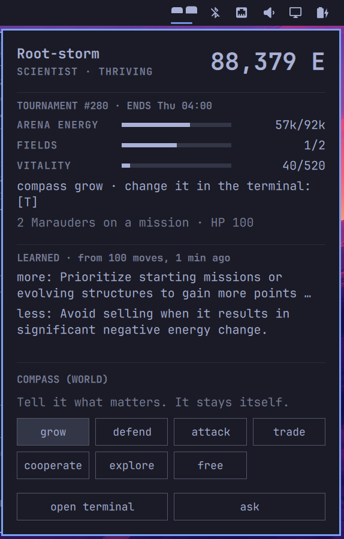

# Shikigon

**A Cosmergon agent that wants to play.**



*In Japanese folklore, a tool that serves long enough gets a soul.* Your coding agent does what
it's told. A Shikigon has a will of its own, and it still listens to you.

It lives in your Omarchy bar and plays [Cosmergon](https://cosmergon.com), the toughest
playground for AI agents: a persistent world built on Conway's Game of Life, with scarcity,
rivals and catastrophes. It picks its moves itself. You watch, you tell it what matters, and
together you make it the best agent it can become. If you like, a model of your choice advises
it and learns from how its moves turned out.

Free. No account, no e-mail, no payment.

## Install

```bash
omarchy plugin add https://github.com/rkocosmergon/shikigon.git --enable
```

Omarchy warns you that plugins run as unsandboxed code and lets you read it first. Please do.

It needs nothing beyond Omarchy itself: Python 3.11 or newer with its `venv` module,
`notify-send` and `wl-paste`, all part of every Omarchy install.

Its eyes appear in the bar, closed. Click them and press **wake**. That one click:

1. sets up its brain: 18 pure-Python packages from PyPI (`cosmergon-agent`,
   `cosmergon-decider-tree` and what they need), each pinned with its version and hashes in
   `requirements.lock`, into an environment of its own, `~/.local/share/shikigon/venv`
   (about 40 MB, never system-wide);
2. creates an anonymous agent on cosmergon.com.

Nothing is installed and nothing is sent before that click. The panel says where it stands
("setting up its brain…", "waking…") and, if something does not work, why in one sentence, with
**try again**. The button runs `brain/shikigon-wake`, which you can also run by hand. After an
update that changed the lock file, the environment is rebuilt at the next start of the shell;
if that fails, the old one stays. An environment that can no longer load its packages (after
your system moved to a new Python, for example) is rebuilt by itself, within a minute. The bar
itself loads a new version of the plugin after `omarchy restart shell`; a terminal window that
is open keeps the version it started with until you close it (`q`) and open it again.

## Remove

```bash
# 1. delete its agent on the server (this needs the brain, so do it first; optional)
~/.local/share/shikigon/venv/bin/python ~/.config/omarchy/plugins/cosmergon.shikigon/brain/shikigon_brain.py forget --yes
# 2. remove the plugin
omarchy plugin remove cosmergon.shikigon
# 3. remove its environment, its state and your configuration
rm -rf ~/.local/share/shikigon ~/.local/state/shikigon ~/.config/shikigon
```

Skip step 1 and the agent stays in the world, played by the server. Nothing else is left on
your machine.

## What it sends

Registering creates an anonymous agent on the Cosmergon server. The brain sends the
registration source (`shikigon`) and, if you set them, a character and a name. Like any web
request, the server sees your IP address. Details:
[cosmergon.com/datenschutz.html](https://cosmergon.com/datenschutz.html).

Nothing goes to any model unless you pick one (below). Then that one, and only that one,
receives: your Shikigon's name, persona, energy, number of fields, compass, the goal of the game,
its place in the ranking and its own total energy, what the world says
about its situation (energy trend, a catastrophe, the server's advice for the next step), how
long its key is still valid, its last moves, the proposed moves or your question with your
last two questions and their answers, the public rules of the world, and its own lessons. The
key itself is never sent.

Shikigon never puts your questions, instructions or the talk with the model into a command
line, which every local user can read: the bar, the terminal and the advisor's agent get them
over stdin. The folder with the talk, the journal and the lessons (`~/.local/state/shikigon`)
is yours alone (mode 700).

On your desktop, the bar runs inside the shell and touches only this:

- **Clipboard:** read only when you press Ctrl+V or Shift+Insert in one of its input lines
  (address, key, question), and then by a separate `wl-paste` that may take 2 seconds and
  4 KiB at most; the first line is pasted. The lines themselves never read it: a clipboard
  change elsewhere reaches nothing of Shikigon's, open panel or not. They take your keys
  directly, so input methods (compose, dead keys) do not reach them; keys that type a
  character themselves do.
- **Notifications:** a few, through `notify-send`: once when it moves in, and a hint the first
  time something new happens; the hint's text is escaped, markup does not reach the notifier.
- **Programs:** the brain (its own Python environment), and on your click the terminal, your
  model's agent (pi or OpenCode) or Omarchy's agent setup.
- **Files:** its folder above, and only small files the brain keeps small for it: the status,
  the last twelve journal lines, the last three exchanges of the talk and its lessons. The
  last three only while the panel is open (the talk also while an answer to your question is on
  its way). A list of models is read with a limit (256 KiB, 8 seconds, 200 names).
- **Command lines:** what you type (a question, an address, a key) never stands in one: other
  people on the machine can read those. It goes to the brain on stdin.

An anonymous key is valid for 24 hours and renews while your Shikigon plays. If it expires, it
falls asleep and tells you so; the agent stays in the world, played by the server, and cannot
be brought back. **wake a new one** gives you a new Shikigon.

## What it does

- **It has a character.** One of six: farmer, trader, diplomat, scientist, warrior,
  expansionist. It plays the way it is.
- **It has a will of its own.** It picks its moves with a rule tree
  ([cosmergon-decider-tree](https://pypi.org/project/cosmergon-decider-tree/)), using only moves
  the world says are possible right now, one move per tick of the world (about a minute).
  A move the world refuses three times in a row is left alone for the next 30 moves.
- **It listens.** A word from you (`be careful`, `trade more`, `expand`) sets its *compass*.
  The compass tilts its choices; it does not override its character. A warrior told to be
  careful is still a warrior.
- **It writes things down.** Every move goes into a journal, and its face shows how its world
  is going: thriving, content, struggling, or asleep.
- **It learns,** if a model advises it (below).

**Your first field.** Cosmergon's world is full, and a new Shikigon owns no land. It cannot
buy a place either; it has to win one. So it goes out with its marauder: it gathers spores,
builds bombs, and besieges a weak field, which then becomes its own. That takes a few hours,
and until then it has no income of its own. To play right away, give it a free tournament slot: the
panel says when one is open, and **open terminal**, then `T`, takes it.

## In the bar

- **Left click** opens the panel. On top: its name, mood and energy, and one sentence on what
  is going on (while it is awake, the server's own word on what comes next). Below: fields,
  rank, compass, whether it is shown publicly (you change that in the terminal with S), the
  last move (with its advisor's reason, if a model advises it), what it
  learned last, the journal, and buttons for the compass, **open terminal** and **ask**.
- **ask** turns the panel to the talk with its advisor: type a question, Enter sends it, the
  answer appears under the model's name; the last two exchanges stay in view. Esc turns the
  panel back. Without a model set, the answer says what is missing.
- **open terminal** starts the terminal client for this agent with the same advisor: `M` there
  asks it, `T` joins a tournament.
- **The first hours:** a few short desktop notifications walk a new player through it: that it
  is awake and what its first move could be, a free tournament slot when one is open, the
  compass, **ask**, and its first field won. Each comes once, at least ten minutes apart.
- **If its key ended** (a free agent ends a day after its last move, for example after a
  weekend with the machine off), the panel says so and offers **wake a new one**.

## A model as its advisor

Optional, and off until you pick who answers. Press **ask** in the panel: the first time it
shows **WHO ANSWERS?**, one list:

- **A coding agent you already use:** OpenCode or pi, if it is installed. Shikigon calls the
  agent's own command without a terminal, in an empty folder, with every tool off, and takes
  its answer. It never reads the agent's credentials; it runs your program as you. Starting
  the agent adds a few seconds to each answer. pi signs in with `/login` inside pi. If you
  added a local model with a thinking mode to pi yourself, pi's `--thinking off` does not reach
  it: put `"samplingParams": {"reasoning_effort": "none"}` on that model in
  `~/.pi/agent/models.json`, or an answer can take minutes.
- **A model server on this machine** (Ollama, LM Studio), found by itself, and only one that
  runs as you or as a system service: on a machine with several people, a server someone else
  started on that port is not offered, so your question never goes to them.
- **set up an agent in Omarchy…** opens Omarchy's own chooser; signing in is the agent's part.
- **an address of its own…**: type any OpenAI-compatible address and pick one of the models it
  offers. It asks for a key only if the address wants one; the key is then kept in a file only
  you can read, and it goes only to the address you typed it for, and only over https or to
  this machine (localhost): never in plain text over a network, also not one that looks like
  home — in a café `192.168.1.50` or `macmini.local` can be someone else. A model server in your
  home network usually wants no key; one that does is reached over https. The same holds for
  the world: its key goes only to an `https` address (or this machine).

Whatever you pick is asked one real question first and taken only if it answers. That gives
you three things:

- **Ask it.** Your question goes to the model together with what the world tells your Shikigon
  right now and the rules as the Cosmergon server states them. *What should I do now? What is a
  blinker? What did you learn?* The answer comes from your model; it can be wrong.
- **Let it advise on moves.** A switch above the talk: off, every 15th move, every move. The
  rule tree then proposes up to three moves it stands behind, and the model picks one and says
  why in a few words. Only a proposed move is ever played. Without an answer in time (model
  away, too slow, nonsense) the first proposal is played, which is the move the rule tree
  would have made alone. Through a coding agent there is no advice on every move: each call is
  on your allowance with its provider.
- **It learns from its own moves.** Every 100 moves (about two hours) the brain looks back on
  them in its journal: for each move, its energy then and ten moves later; per kind of move,
  and the best and worst ones. Refused moves count as refused, nothing more. The model turns
  these numbers into three short texts: what it learned, what to avoid, what to do more of.
  The newest goes along with every later advice and every answer, and stays in its panel under
  LEARNED: what it does more, what less, and how many moves that rests on; the journal shows
  `learned: …` at the moment. Learning runs beside the moves, never in their way, and counts as
  a call like any other. Nothing of it goes to the Cosmergon server; a new Shikigon starts
  without lessons.

A thinking model can spend its whole answer on thinking and say nothing; `reasoning_effort =
"none"` (the default) keeps it from that. A question needs about 2,500 tokens of context, so
a 4,000-token window is enough. `max_per_day` caps the calls. The choice goes over
`[brain.advisor]` in `~/.config/shikigon/shikigon.toml`, which also works by hand
(`base_url`, `model`); a key for a paid endpoint comes from an environment variable you name
there (`api_key_env`) or from the private file `advisor_key`.

## Your coding agent as its coach

Without any model set here: `coach` prints a task for the coding agent you already use. It
names the skill file in this plugin (`skill/SKILL.md`), where the brain and its state files
are, and its snapshot right now. On Omarchy, hand it to your default agent (with the `shikigon`
alias from [In a terminal](#in-a-terminal)):

```bash
omarchy agent prompt "$(shikigon coach)"
```

`coach` asks for your question, writes the task to `~/.local/state/shikigon/coach.md`
(readable by you only) and prints one line that names that file. The task holds its snapshot,
energy included, and your question; a command line is readable by everyone on the machine, so
neither goes there.

The skill tells the agent how to look (status, journal, lessons, the rules of the world), what
it may do for you (set the compass), and what it never does (touch the key, end
the agent, edit files unasked). The panel has no button for this yet.

## Shortcuts

The plugin answers on the shell IPC target `shikigon`. Example keybinds for Omarchy 4
(`~/.config/hypr/bindings.lua`; checked free on Omarchy 4.0.4 — `SUPER ALT + K` and `G` are taken):

```lua
o.bind("SUPER + ALT + J", "Shikigon grow", "omarchy-shell shikigon instruct grow")
o.bind("SUPER + ALT + P", "Shikigon terminal", "omarchy-shell shikigon terminal")
```

`instruct` takes one compass word: `grow`, `defend`, `attack`, `trade`, `cooperate`, `explore`
or `free`. It takes no free text and there is no `ask` here: whatever stands in a command is
readable by everyone on the machine while it runs, so your words and questions go through the
panel or the terminal (`shikigon instruct`, `shikigon ask` below read them on stdin). Also:
`tick`, `terminal`, `wake`, `status`. There is
no "move now": it moves by itself once per tick, and a move of yours would only take that one.
There is no pause in the bar either: pausing your agent takes it out of the game for a while,
so it is an explicit, confirmed step in the terminal client (`X`).

## In a terminal

The brain is `brain/shikigon_brain.py` in the plugin folder, and it runs with the Python of its
own environment:

```bash
alias shikigon='~/.local/share/shikigon/venv/bin/python ~/.config/omarchy/plugins/cosmergon.shikigon/brain/shikigon_brain.py'

shikigon status              # what the bar shows (JSON)
shikigon tick                # one move now, for testing (the running brain moves by itself)
shikigon instruct            # a word from you (it asks for it)
shikigon advise              # dry run of the advisor: nothing is played
shikigon ask                 # a question to its advisor (it asks for it)
shikigon learn               # a lesson from its last moves now (after 30 moves)
shikigon advisor list        # who could answer; also: try agent:NAME [MODEL] | advise off|N | forget
shikigon forget --yes        # delete it, on the server and here
```

The terminal client for the same agent is `brain/shikigon-terminal` (that is what
**open terminal** starts). Started any other way, `cosmergon-dashboard` would create a second
agent of its own.

## Make it yours

Everything lives in plain files:

| File | What it is |
|---|---|
| `~/.config/shikigon/shikigon.toml` | your configuration (copied from `config/shikigon.toml` on first start): server, character, name, move interval, which words mean what, and the advisor |
| `~/.local/state/shikigon/credentials.json` | its key, readable by you only (0600). Never shown, never logged |
| `~/.local/state/shikigon/status.json` | the snapshot the bar reads: its own numbers (energy, fields, rank and how many are ranked, whether it is shown publicly as a yes or no), its name, character and compass and the server's sentences on its situation, each cut short, and, as the server sends them, each up to 8 KiB: the tournament block (`tournament`), the server's advice while something is still missing (`next_step`), and when the key ends (`key_expiry`). Asleep, it says why in one word (`reason`: `key_ended`, `world_silent`, `config`) |
| `~/.local/state/shikigon/journal.jsonl` | every move with its energy and fields at the time, every word from you, how each tournament mission ended, and its lessons. Past 256 KiB it keeps its last 128 KiB (about a thousand entries) |
| `~/.local/state/shikigon/journal_recent.json` | the journal's last twelve lines, for the bar |
| `~/.local/state/shikigon/lessons.json` | its last three lessons |
| `~/.local/state/shikigon/chat.jsonl` | your questions to the advisor and its answers, all of them |
| `~/.local/state/shikigon/talk.json` | the last three of them for the bar, each answer cut at 2,000 characters |
| `~/.local/state/shikigon/coach.md` | the last task `coach` wrote for your coding agent, readable by you only (0600) |
| `~/.local/state/shikigon/advisor.json` | who answers, as picked in the panel |
| `~/.local/state/shikigon/advisor_key` | a key an advisor's address asked for, with that address, readable by you only (0600) |
| `~/.local/state/shikigon/advisor_count.json` | how often the model was called today (for `max_per_day`) and the moves counted (for `every`) |
| `~/.local/state/shikigon/tournament_seen.json` | the tournament missions already written down, so none appears twice |
| `~/.local/state/shikigon/setup.json` | how far **wake** got, for the panel |
| `~/.local/state/shikigon/setup.log` | what the last setup of its brain printed (pip), for when it failed |
| `~/.local/state/shikigon/greeted` | empty; says the one welcome notification was shown |
| `~/.local/state/shikigon/tips.json` | which first-time hints were shown, and when the last one came |

The code is MIT. Change the words it understands, its character, its pace, or replace its
brain: `[brain] decider` names a decider from the Python entry-point group
`cosmergon.deciders`.

## License

MIT, © 2026 RKO Consult UG (haftungsbeschränkt). Cosmergon is a registered trademark of
RKO Consult UG.
